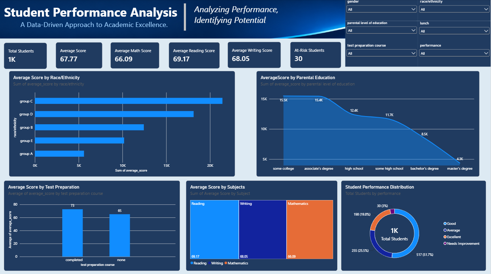

# 🎓 Student Performance Analysis

### Turning Student Data into Meaningful Academic Insights

## 📌 Project Overview

Student Performance Analysis is a data analytics project focused on exploring students' academic performance across Mathematics, Reading, and Writing.

The project uses Python for data cleaning, exploratory data analysis (EDA), visualization, and at-risk student identification. Power BI is used to create an interactive dashboard to present key academic insights.

## 🎯 Project Objectives

- Analyze students' performance across different subjects.
- Understand the relationship between gender and academic scores.
- Explore the impact of parental education on student performance.
- Analyze the relationship between test preparation and scores.
- Examine the relationship between lunch type and academic performance.
- Identify students who may need academic improvement.

## 🛠️ Tools & Technologies

- Python
- Jupyter Notebook
- Pandas
- NumPy
- Matplotlib
- Seaborn
- Power BI
- Microsoft Excel
- GitHub

## 📂 Project Structure

```text
Student-Performance-Analysis/
│
├── Student_Performance_Analysis.ipynb
├── Student_Performance_Final.csv
├── At_Risk_Students.csv
├── Dashboard.png
└── README.md
```

## 🔍 Project Workflow

1. Data Collection
2. Data Cleaning and Preprocessing
3. Exploratory Data Analysis (EDA)
4. Feature Engineering
5. Data Visualization
6. At-Risk Student Segmentation
7. Power BI Dashboard Development
8. Insights and Recommendations

## 📊 Key Analysis

The project explores five major factors:

1. Gender-wise academic performance.
2. Parental education and student scores.
3. Impact of test preparation courses.
4. Comparison of Mathematics, Reading, and Writing scores.
5. Relationship between lunch type and academic performance.

## 📈 Key Findings

- Average Mathematics Score: 66.09
- Average Reading Score: 69.17
- Average Writing Score: 68.05
- Average Overall Score: 67.77
- Total Students Analyzed: 1,000
- Students Identified as At-Risk: 30

Reading has the highest average score among the three subjects.

Students who completed the test preparation course achieved higher average scores than students who did not complete it.

## ⚠️ At-Risk Student Analysis

Students with an average score below 40 were classified as needing improvement.

- Total At-Risk Students: 30
- Female Students: 16
- Male Students: 14

This segmentation helps identify students who may benefit from additional academic support.

## 📊 Power BI Dashboard

The interactive dashboard presents:

- Total Students
- Average Score
- Average Mathematics Score
- Average Reading Score
- Average Writing Score
- At-Risk Students
- Average Score by Race/Ethnicity
- Average Score by Parental Education
- Average Score by Test Preparation
- Average Score by Subjects
- Student Performance Distribution

### Dashboard Preview



## 💡 Recommendations

1. Provide additional academic support to students identified as at-risk.
2. Encourage students to complete test preparation programs.
3. Focus on improving Mathematics performance through targeted practice and learning support.

## 📁 Dataset

Dataset: Students Performance in Exams

The dataset contains students' demographic information, parental education, lunch type, test preparation status, and scores in Mathematics, Reading, and Writing.

## 👩‍💻 Author

**Niharika Negi**
